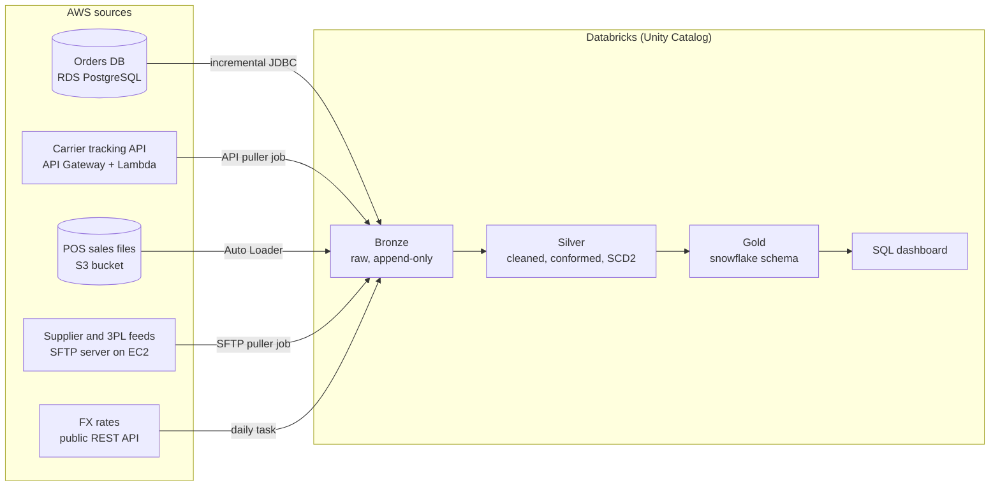

# RetailPulse Data Platform

An end-to-end data engineering project. Four different AWS source systems feed a Databricks lakehouse built on the medallion architecture (bronze, silver, gold). The gold layer is a snowflake-schema model.

It is built to look and run like a production setup: infrastructure as code, separate dev and prod environments, secrets in a vault, incremental loads, data quality checks and CI.

## Business case

**RetailPulse** is a fictional mid-size retailer. It sells home goods, electronics and apparel through 40 physical stores and an online shop in the United States, the United Kingdom and Germany. Each channel runs on its own system, so nobody can answer simple cross-channel questions. The data platform brings every source into one governed model that answers these questions:

1. What are daily net sales, margin and units by product category, store region and channel (online vs store), in one reporting currency?
2. Which products are likely to run out of stock in the next 7 days, given warehouse stock and recent sales?
3. How do carriers perform on delivery time and late deliveries, by region and shipping method?
4. How do loyalty tiers differ in order frequency, basket size and return rate?
5. Which promotions lifted sales, and by how much compared with the 4 weeks before?
6. Which suppliers deliver late or short, and how does that affect stock-outs?

## Architecture



| # | Source type | AWS service | What it holds | Ingestion pattern |
|---|---|---|---|---|
| 1 | Relational database (OLTP) | RDS PostgreSQL | Customers, products, stores, online orders, payments, returns | Incremental JDBC on `updated_at` |
| 2 | REST API | API Gateway + Lambda + DynamoDB | Carrier shipments and tracking events | Paged API pull to a volume, then Auto Loader |
| 3 | Object storage drop | S3 | In-store POS sales (one CSV per store per day), promotions calendar (JSON) | Auto Loader |
| 4 | SFTP | EC2 OpenSSH server | 3PL warehouse inventory snapshots, supplier purchase-order receipts | SFTP pull to a volume, then Auto Loader |
| + | Public API | none | Daily FX rates | Small daily task |

## Repository layout

```
├── data_generator/      # Python package that generates realistic data for every source
├── contracts/           # schema contract (YAML) for each source feed
├── infra/terraform/     # AWS sources and Databricks objects as code
├── services/            # Lambda code for the mock carrier API
├── databricks/          # Asset Bundle: ingestion jobs, bronze and silver pipelines
│   └── gold/            # reserved for the snowflake model
├── docs/                # project plan, architecture decisions (ADRs), data dictionary
├── tests/
└── .github/workflows/   # CI
```

## Progress

| Milestone | What it delivers | Status |
|---|---|---|
| M0 Scaffold | Repo layout, README, project plan, CI skeleton | Done |
| M1 Data generator | Seeded master data and generators for every source, with tests | Planned |
| M2 AWS sources | Terraform for S3, RDS, carrier API, SFTP server, secrets, IAM, budget alert | Planned |
| M3 Load the sources | Seed 90 days of history into each source, then a daily simulator | Planned |
| M4 Databricks foundation | Catalogs, schemas, storage credential, external locations, secret scope | Planned |
| M5 Bronze | One ingestion job per source, with audit columns and watermarks | Planned |
| M6 Silver | Cleaning, dedupe, conformed keys, currency and time zones, SCD2, quarantine | Planned |
| M7 Gold | Snowflake-schema model answering the six business questions | Planned |
| M8 Orchestration and ops | One end-to-end workflow, alerts, audit table, CI deploys | Planned |
| M9 Showcase | Dashboard, screenshots, cost notes, lessons learned | Planned |

## Getting started

Requirements: Python 3.11 or newer, Terraform 1.6 or newer (from M2), the Databricks CLI (from M4), and an AWS account.

```bash
python -m venv .venv && source .venv/bin/activate
pip install -e ".[dev]"
make test
```

AWS and Databricks credentials are never stored in this repository. Configure them locally with `aws configure` (or AWS SSO) and `databricks auth login`.

See [docs/project-plan.md](docs/project-plan.md) for the full plan.
