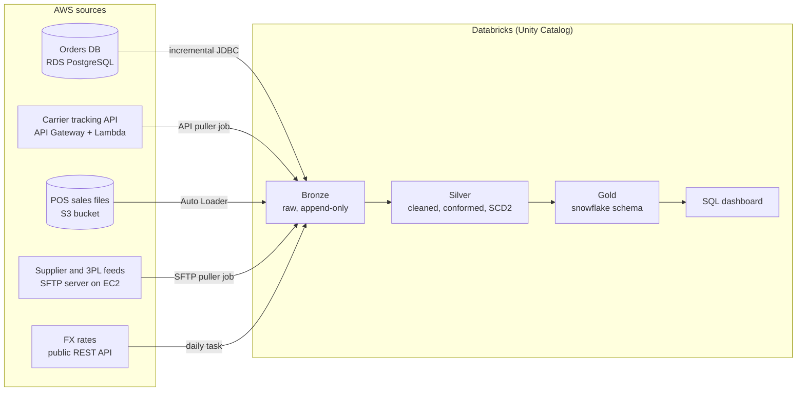

# RetailPulse Data Platform

An end-to-end data engineering project. Four different AWS source systems feed a Databricks lakehouse built on the medallion architecture (bronze, silver, gold). The gold layer is a snowflake-schema model.

It is built to look and run like a production setup: infrastructure as code, separate dev and prod environments, secrets in a vault, incremental loads, data quality checks and CI.

## Business case

**RetailPulse** is a fictional mid-size retailer. It sells home goods, electronics and apparel through 40 physical stores and an online shop in the United States, the United Kingdom and Germany. Each channel runs on its own system, so nobody can answer simple cross-channel questions. The data platform brings every source into one governed model that answers these questions:

1. What are daily net sales, margin and units by product category, store region and channel (online vs store), in one reporting currency?
2. Which products are likely to run out of stock in the next 7 days, given warehouse stock and recent sales?
3. How do carriers perform on delivery time and late deliveries, by region and shipping method?
4. How do loyalty tiers differ in order frequency, basket size and return rate?
5. Which promotions lifted sales, and by how much compared with the 4 weeks before?
6. Which suppliers deliver late or short, and how does that affect stock-outs?

## Architecture



| # | Source type | AWS service | What it holds | Ingestion pattern |
|---|---|---|---|---|
| 1 | Relational database (OLTP) | RDS PostgreSQL | Customers, products, stores, online orders, payments, returns | Incremental JDBC on `updated_at` |
| 2 | REST API | API Gateway + Lambda + DynamoDB | Carrier shipments and tracking events | Paged API pull to a volume, then Auto Loader |
| 3 | Object storage drop | S3 | In-store POS sales (one CSV per store per day), promotions calendar (JSON) | Auto Loader |
| 4 | SFTP | EC2 OpenSSH server | 3PL warehouse inventory snapshots, supplier purchase-order receipts | SFTP pull to a volume, then Auto Loader |
| + | Public API | none | Daily FX rates | Small daily task |

> **Databricks Free Edition.** The workspace is Databricks Free Edition, serverless compute only. A connectivity check showed that it can reach every source directly (HTTPS, Postgres on 5432 and SFTP on 22), so the pipelines pull straight from AWS.

## Data generator

`data_generator/` simulates 90 days of the business, one day at a time. The channels share state: online and store sales draw down warehouse stock, low stock raises purchase orders, late supplier deliveries cause stock-outs, and customer spend moves customers up loyalty tiers. Every source is written from that one simulation, so keys line up across systems the way they do in a real company.

```bash
make generate          # full volume, about 90 seconds
make generate-small    # 14 days at 5% volume, a few seconds
```

The same seed always produces the same files. Output goes to `output/` (git-ignored) and mirrors the four source systems:

| Folder | Source system | Contents (default run) |
|---|---|---|
| `output/postgres/` | RDS PostgreSQL | 12 tables as CSV: ~43k customers, ~137k orders, ~230k order lines, payments, returns, products, stores |
| `output/carrier_api/` | Carrier REST API | `shipments.jsonl`: ~130k shipments with nested tracking events |
| `output/s3/pos_sales/` | S3 file drop | ~3,500 CSV files (one per store per day, ~1M lines), by landing date |
| `output/s3/promotions/` | S3 file drop | weekly JSON export of the promotions calendar |
| `output/sftp/3pl/inventory/` | SFTP | daily stock file per warehouse (pipe-delimited, header and trailer) |
| `output/sftp/suppliers/deliveries/` | SFTP | daily goods-received file, keyed by the supplier's own product code |

The schema of every feed is defined in [`contracts/`](contracts/), and the tests check the generator against it. The Postgres DDL is in [`data_generator/sources/postgres_schema.sql`](data_generator/sources/postgres_schema.sql).

### Data problems built in on purpose

Silver has real cleaning work to do, because the sources behave the way production sources do:

| Source | Problem | What the pipeline must do |
|---|---|---|
| Postgres | Rows are updated in place (order status, customer address, loyalty tier) | Capture changes incrementally; build SCD Type 2 history for customers |
| Postgres | Some customers signed up twice, with the email in a different case | Deduplicate customers on a normalised email |
| Carrier API | EuroExpress sends event types in lower case; some events arrive twice | Standardise codes; deduplicate on `event_id` |
| POS files | About 3% of files land 2 to 3 days late; some files are resent | Process by business date, not arrival date; deduplicate resent files |
| POS files | Timestamps are store-local with no time zone; some SKUs are lower case or unknown | Convert with the store's time zone; quarantine unknown SKUs |
| Promotions | The same promotion appears in many weekly exports and can change between them | Keep the latest version of each promotion |
| SFTP inventory | About 1 file in 50 is truncated, so its trailer count does not match | Reconcile detail rows with the trailer; reject bad files |
| SFTP deliveries | Layout changes from v1 to v2 on day 45 (renamed column, new columns, timestamps with offset) | Handle schema evolution by reading the version in the header |
| SFTP deliveries | Suppliers use their own product codes | Map `vendor_sku` to our product through the product master |
| All | Three currencies, many time zones | Convert to a reporting currency with the FX feed; store UTC plus local dates |

## AWS sources

`infra/terraform/` creates every source system in one AWS account (`us-east-1`): a `bootstrap` stack for the Terraform state bucket, a `sources` module, and the `envs/dev` environment.

| Source | AWS resources | Notes |
|---|---|---|
| Orders database | RDS PostgreSQL 17, `db.t4g.micro`, 20 GB gp3, encrypted | TLS enforced (`rds.force_ssl`), 1-day backups |
| Carrier API | DynamoDB (on-demand) + Lambda (Python, arm64) + API Gateway REST API | API key and usage plan; a GSI on the UTC day of `updated_at` serves `updated_since` pulls |
| File drop | S3 bucket `sources`, versioned, encrypted, TLS-only | A separate `simulator` bucket holds the pre-generated year; pipelines cannot read it |
| SFTP | OpenSSH on EC2 `t4g.nano` (Amazon Linux 2023) | Chrooted, key-only SFTP user; admin access through SSM Session Manager |

Connection details and secrets live in SSM Parameter Store under `/retailpulse/dev/`. Two IAM users exist for Databricks: `simulator` (writes into the sources) and `pipelines` (read-only). Their access keys are created straight into a Databricks secret scope by `infra/scripts/store-aws-key-in-databricks.ps1`, so they never appear in code or Terraform state.

**Cost.** RDS and the SFTP server run only in a daily window (06:00 to 08:00 UTC, EventBridge Scheduler), and everything else is pay-per-request. The target is $5 to $8 a month, with an AWS Budgets alert at $10.

**Known gap.** Databricks Free Edition serverless has no fixed egress IP, so ports 5432 and 22 are open to the internet. Postgres requires TLS and a 32-character password, and SFTP accepts keys only. A paid workspace would use private connectivity or an IP allow-list instead.

```bash
make infra-bootstrap               # once: the Terraform state bucket
cp infra/terraform/envs/dev/backend.hcl.example infra/terraform/envs/dev/backend.hcl          # fill in the bucket
cp infra/terraform/envs/dev/terraform.tfvars.example infra/terraform/envs/dev/terraform.tfvars  # fill in alert_email
make infra-init infra-plan infra-apply
make sources-up / sources-down     # outside the daily window
make infra-destroy                 # remove everything
```

## Daily source simulator

The sources behave like live systems: they hold history from 2026-06-30 and receive the next day's changes every morning.

1. `python -m data_generator.daily` simulates a fixed one-year calendar once and writes one folder per day with only that day's changes: new and updated database rows, updated shipments, and the files that arrive. Tests prove that replaying the days in order rebuilds exactly the full dataset.
2. The folders sit in the private `simulator` bucket, which the pipelines cannot read.
3. `python -m data_generator.publish` applies every day not yet published, up to yesterday: Postgres upserts (one transaction per day), DynamoDB puts, S3 copies, and SFTP uploads written as `.part` and renamed. Every write replaces by key, so a rerun is harmless, and a missed day is caught up on the next run.
4. The Databricks job `retailpulse-source-simulator` runs it at 06:10 UTC on serverless, inside the window when RDS and the SFTP server are up. It is defined in `databricks.yml` and deployed with `databricks bundle deploy`.

On 2026-11-03 the sources held 43,637 customers, 194,797 orders, 329,009 order lines, 185,537 shipments, 4,895 S3 files and 625 SFTP files, all checked against the day folders.

## Reading the sources

What the bronze layer works with. Connection details are in SSM Parameter Store under `/retailpulse/dev/`; Databricks reads them with the `pipelines` IAM user, whose key is in the `retailpulse-dev` secret scope (`aws_access_key_id`, `aws_secret_access_key`). `databricks/notebooks/01_source_connectivity_test.py` shows each connection.

| Source | Where | Login | New data appears |
|---|---|---|---|
| Orders database | `postgres/host`, database `retailpulse`, schema `shop`, TLS required | `postgres/reader_username` / `postgres/reader_password` (read-only) | Rows inserted and updated in place; pull incrementally on `updated_at` |
| Carrier API | `carrier_api/url`, header `x-api-key: <carrier_api/api_key>` | API key | `GET ?updated_since=<ISO>&limit=<=1000`, then follow `next_page_token`; no `updated_since` pages through everything |
| File drop | bucket `s3/sources_bucket`: `pos_sales/landing_date=YYYY-MM-DD/`, `promotions/export_date=YYYY-MM-DD/` | IAM `pipelines` user | New files each morning; about 3% of POS files land 2 to 3 days late, some are resent |
| SFTP | host `sftp/host` (changes when the server restarts), user `sftp/username`, key `sftp/private_key` | ED25519 key | `3pl/inventory/` and `suppliers/deliveries/` daily; skip `*.part`; move pulled files to `archive/` |

RDS and the SFTP server run 06:00 to 08:00 UTC. Outside that window, start them with `make sources-up` (or `rds:StartDBInstance` / `ec2:StartInstances`, which the `pipelines` user may call) and stop them with `make sources-down`.

## Repository layout

```
├── data_generator/      # simulates the business and writes data for every source
│   ├── master.py         # products, stores, customers, suppliers, promotions
│   ├── activity/         # day-by-day simulation (orders, POS, shipments, returns, stock)
│   ├── sources/          # one writer per source system, plus the Postgres DDL
│   ├── simulate.py       # command line entry point: the whole dataset at one moment
│   ├── daily.py          # the same data split into one folder of changes per day
│   └── publish.py        # applies pending days to the live AWS sources
├── contracts/           # schema contract (YAML) for each source feed
├── infra/terraform/     # AWS sources and Databricks objects as code
├── services/            # Lambda code for the mock carrier API
├── databricks.yml       # Asset Bundle: the source simulator job (pipelines can be added)
├── databricks/
│   ├── resources/       # bundle job definitions
│   ├── simulator/       # job entry point for the daily publisher
│   ├── notebooks/       # connectivity checks
│   └── gold/            # reserved for the snowflake model
├── docs/                # project plan, architecture decisions (ADRs), data dictionary
├── tests/
└── .github/workflows/   # CI
```

## Progress

| Milestone | What it delivers | Status |
|---|---|---|
| M0 Scaffold | Repo layout, README, project plan, CI skeleton | Done |
| M1 Data generator | Seeded master data and generators for every source, data contracts, tests | Done |
| M2 AWS sources | Terraform for S3, RDS, carrier API, SFTP server, secrets, IAM, budget alert | Done |
| M3 Load the sources | History since 2026-06-30 in every source, then a daily simulator job in Databricks | Done |
| M4 Databricks foundation | Catalogs, schemas, storage credential, external locations, secret scope | Planned |
| M5 Bronze | One ingestion job per source, with audit columns and watermarks | Planned |
| M6 Silver | Cleaning, dedupe, conformed keys, currency and time zones, SCD2, quarantine | Planned |
| M7 Gold | Snowflake-schema model answering the six business questions | Planned |
| M8 Orchestration and ops | One end-to-end workflow, alerts, audit table, CI deploys | Planned |
| M9 Showcase | Dashboard, screenshots, cost notes, lessons learned | Planned |

## Getting started

Requirements: Python 3.11 or newer, Terraform 1.10 or newer (from M2), the Databricks CLI (from M4), and an AWS account.

```bash
python -m venv .venv && source .venv/bin/activate
pip install -e ".[dev]"
make test
```

AWS and Databricks credentials are never stored in this repository. Configure them locally with `aws configure` (or AWS SSO) and `databricks auth login`.

See [docs/project-plan.md](docs/project-plan.md) for the full plan and [docs/HANDOFF.md](docs/HANDOFF.md) for the current state, open questions and next steps.
